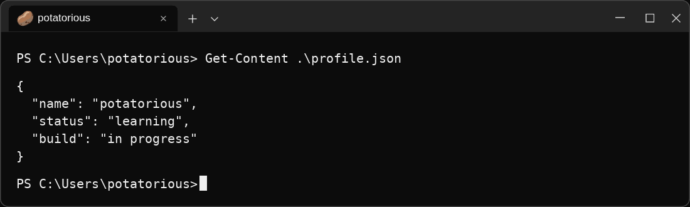

<pre>
PS C:\Users\potatorious&gt; Get-ChildItem .\certifications

    Directory: C:\Users\potatorious\certifications

Name
----
<a href="https://www.freecodecamp.org/certification/potatorious/responsive-web-design-v9">Responsive Web Design</a>
<a href="https://www.freecodecamp.org/certification/potatorious/python-v9">Python</a>

PS C:\Users\potatorious&gt; <a href="https://www.freecodecamp.org/potatorious">Start-Process freeCodeCamp</a>
</pre>
